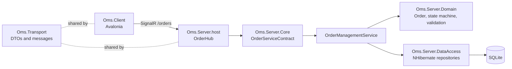
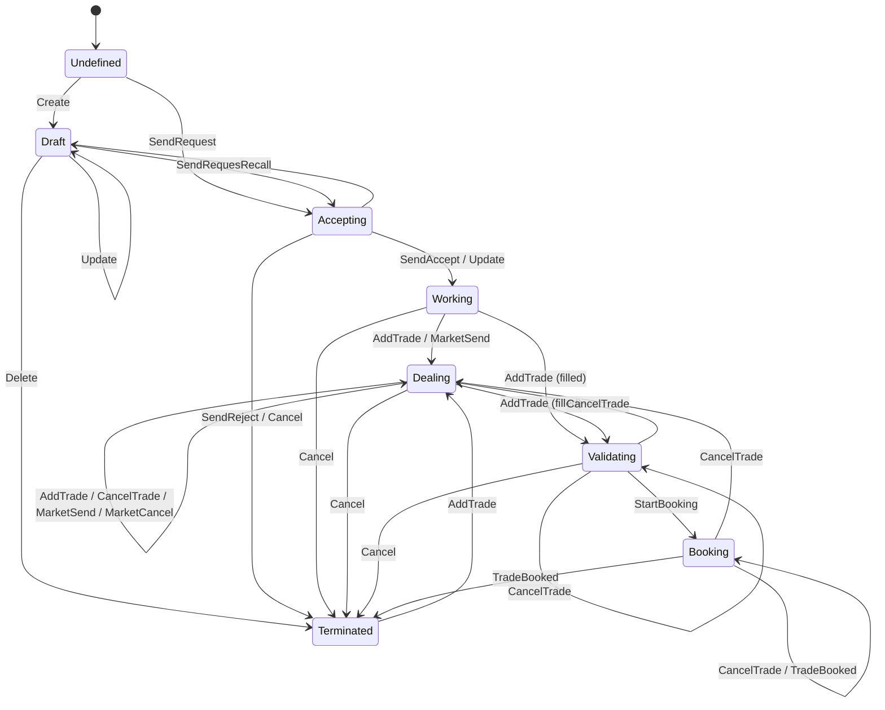
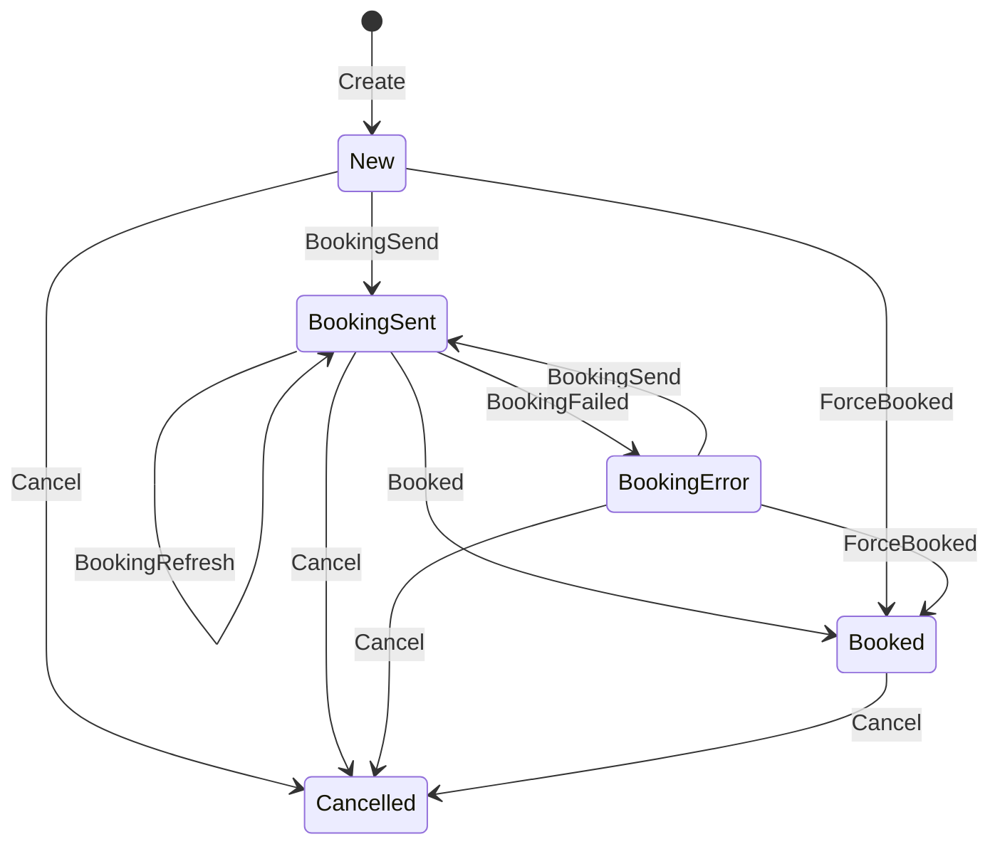

# YOMS architecture

YOMS is a small Order Management System: clients submit orders, the server runs each order through a workflow, persists the full history, and pushes changes back to subscribed clients.

## Components

| Project                 | Responsibility                                                                                                                                                           |
|-------------------------|--------------------------------------------------------------------------------------------------------------------------------------------------------------------------|
| `Oms.Transport`         | DTOs, request/response messages and `IOrderServiceContract`. The only assembly shared by client and server.                                                              |
| `Oms.Server.Domain`     | Business model: `Order`, `Trade`, `Security`, `Fund`, `User`; the order workflow; FluentValidation validators; repository interfaces. No persistence or transport types. |
| `Oms.Server.DataAccess` | NHibernate/FluentNHibernate automapping and repositories behind `IRepositoryFacade`. Runs on SQLite through `MicrosoftDataSqliteDriver`.                                 |
| `Oms.Server.Core`       | Application layer: `OrderManagementService` maps request commands to domain operations, `DtoMapperExtensions` maps domain to DTOs.                                       |
| `Oms.Server.host`       | ASP.NET Core process, DI registration and the SignalR `OrderHub`.                                                                                                        |
| `Oms.Client`            | Cross-platform Avalonia UI (CommunityToolkit.Mvvm, Microsoft DI).                                                                                                        |
| `Oms.Framework`         | Task dispatcher queues/bags and other shared utilities.                                                                                                                  |

## Request flow

1. The client sends a request (`OrderEditionRequest`, `OrderRequest`, `OrderMarketRequest` or `OrderTradeRequest`) to a hub method: `HandleOrderEdition`, `HandleOrder`, `HandleOrderMarket` or `HandleOrderTrade`. SignalR does not allow overloaded hub methods, hence four names.
2. `OrderHub` forwards to `IOrderServiceContract` (`OrderServiceContract`), which calls `OrderManagementService.HandleRequest`.
3. `OrderManagementService` resolves the requester from the request token (the user's login; an unknown user fails every order of the request). For each order of the request it loads the order (or builds a new one for Create and Stash), looks up the command (`EditionCommand`, `OrderStateCommand`, `OrderMarketCommand`) in `OrderCommandMappings` and runs the matching `Order` method with the requester as trigger context. Trade requests (`OrderTradeCommand`: `AddTrade`, `CancelTrade`, `BookTrade`) carry the order id and the trade in a `TradeDto`; the service loads the order, finds the trade by id among `Order.GetTrades()` and calls `AddTrade`, `CancelTrade` or `TradeBooked` (a trade that was not sent to booking is first forced to Booked, see the trade life cycle).
4. Each call fires a trigger on the order's state machine and returns a `GenericResult`. A created order (`Create`) that `IAcceptanceService.IsAutoAccepted` accepts (every order, today) is accepted straight away with `SendAccept`, so it is Working when it is saved; otherwise it stays in Accepting. A successful order is saved (`Add` when new, `Update` otherwise); a failed one is reported and does not stop the others. The service returns one `OrderCommandResult` per order, in request order.
5. `OrderServiceContract` answers with one outcome per order: `Response<Tuple<OrderDto, GenericResultDto>, EditionCommand>` for edition requests (the order as saved, or as submitted when it failed) and `Response<Tuple<int, GenericResultDto>, ...>` (order id and outcome) for state, market and trade requests.
6. It then raises `OrderListUpdated` with the orders that changed: Add for created orders, Update for edited orders and for state, market and trade changes, Delete for deleted orders. Nothing is raised when every order failed. Clients call `SubscribeToEvents` to join a SignalR group, and the host forwards the event to it as `OrderListUpdated(ItemOperationType, OrderDto[])`.

### Queries and the order DTO

Besides the four commands the hub has three queries, without arguments, so that a client can fill itself before it follows the pushed changes: `GetOrders` (every order, with its state), `GetSecurities` (the active securities an order can be placed on, i.e. with a currency and a type) and `GetFunds`.

An `OrderDto` carries the editable data (security, fund, way, type, quantity, prices, validity, dates, client reference), who created and owns it, and what the server computed: `State` (Draft, Accepting, Working, ...), `Status` (New, PartiallyFilled, CancelPending, ...) and `RemainingQuantity`. Both are strings, so a client does not need the domain enums. `Trades` lists the executions of the order, cancelled ones included, as `TradeDto` (id, order id, way, quantity, net amount and `State`: New, BookingSent, Booked, Cancelled or BookingError). An update of an order is pending until it is accepted: the DTO keeps the old values and `Status` is `UpdatePending`.

Request messages carry the login of the user in `Token`, the command, the list of items (DTOs or order ids) and a `TransactionMode` that is not used yet.

## Order model: event sourcing

An `Order` has no stored state field. It holds a list of `OrderEventLog` entries (`EventLogs`); each records the trigger, its `TriggerStatus`, the resulting `OrderStateMachine.State`, the `TriggerContext` (user and date) and, for data changes, the editable or dealing parameters.

`Order.ComputeOrderData()` replays the non-failed events to rebuild the current `OrderData` (editable data, routing/dealing data, state, pending trigger) and then derives `OrderStatus` (New, PartiallyFilled, Filled, Cancelled, ...). The state machine is re-initialised from that state before each command, so the log is the single source of truth.

## Order workflow

The state machine is designed in `Oms.Server.Domain/Workflow/OrderStateMachine.stateless` (Stateless Designer) and generated into `OrderStateMachine.cs`. Guards are exposed as `GuardClauseFrom<A>To<B>UsingTrigger<T>` delegates, `OrderStateMachine.Custom.cs` adds the initialisation trigger.

Where two transitions share a trigger, guards in `Order.CreateStateMachine` pick the target:

- `AddTrade` (from Working or Dealing): to Validating when the order is fully executed once the new trade is counted, otherwise to Dealing.
- `CancelTrade` (from Validating or Booking): back to Dealing when cancelling leaves the order not fully executed, otherwise it stays put.
- `TradeBooked` (from Booking): to Terminated when every active trade is booked, otherwise it stays in Booking. An order terminated this way has the status Filled (or OverFilled), not Cancelled.

Cancel and Update are pending commands: they are logged as Pending and only take effect, with the data sent with them, when `AcceptPending` is called. `RejectPending` discards them.

## Trade life cycle

A `Trade` is created by `Order.AddTrade` and records its own event log. Clients reach it with `OrderTradeRequest`: `AddTrade` (order id, way, quantity, net amount), `CancelTrade` and `BookTrade` (order id and trade id). `BookTrade` first forces a New or BookingError trade to Booked, since there is no booking system, then books it on the order. The trades of an order, cancelled ones included, are in `OrderDto.Trades`.

## Persistence

`NHibernateHelper` (internal singleton) builds the session factory with FluentNHibernate automapping over the domain assembly. Four pieces make the domain mappable:

- `InterfaceReferenceConvention` points every association typed as an interface (`IUser`, `IFund`, `ISecurity`, `IOrder`, `ITrade`, `ITriggerContext`, the event parameters, ...) to the entity class that implements it, and saves the objects an order owns (basket, initial referential data, trigger contexts, event parameters) together with it.
- `ExplicitTypeSource` adds the closed generic event logs (`OrderParameterEventLog<IOrderEditableData>`, ...), which assembly scanning cannot find. Each event log hierarchy is one table with a discriminator (`EventLogDiscriminatorConvention` gives readable values) and one parameter column per parameter type.
- The mapping override of `Order` ignores the computed members; `Trade` stores its own quantity, amount, state and side. Both map the event logs as lists. A `Trade` is owned by the dealing event parameter that references it, so it is saved with the order.
- `Microsoft.Data.Sqlite` cannot describe its schema, so reserved-word discovery is turned off.

The provider comes from the `OmsDB` connection string in the host's `App.config`: `SQLite` or `PostgreSQL` (an Oracle branch exists but needs a .NET provider package). For SQLite the string is the database file, relative to the working directory (`oms.sqlite`). The schema is created once, when that file is missing or empty; it is never dropped or migrated. A fingerprint of the DDL the mappings generate is stored in the file (`PRAGMA user_version`) and checked at every start, so a file from another mapping version makes the host fail with a message to delete it. On PostgreSQL, `SchemaUpdate` adds the missing tables at start.

## Hosting and configuration

`Oms.Server.host` is an ASP.NET Core application listening on `http://localhost:9001`. `Program.cs` registers the repositories, `OrderManagementService` and `OrderServiceContract` as singletons, maps `OrderHub` at `/orders` and forwards `OrderServiceContract.OrderListUpdated` to the hub's subscriber group.

| Setting | Effect |
|---|---|
| `OmsDB` connection string (`App.config`) | SQLite database file, default `oms.sqlite` in the working directory |
| `SeedDevelopmentData` (environment variable or command line, default `true`) | Adds demo data when the database has no active user: the user `trader`, the funds Alpha Fund and Beta Fund, and three securities (equity, bond, future). `DevelopmentData` is the code. Set it to `false` for a real database. |
| `log4net.config` | Console logging, read from the application directory |

There is no authentication: a request is run as the user whose login it carries.

## Tests

| Project | What it runs |
|---|---|
| `Oms.Server.Domain.Tests` | The order and trade workflows, validation, event sourcing |
| `Oms.Server.Core.Tests` | `OrderManagementService`, `OrderServiceContract`, DTO mapping, JSON round trips of the messages |
| `Oms.Server.DataAccess.Tests` | Repositories and the order service on a real database: SQLite, or PostgreSQL with `OMS_TEST_DB=postgres` (Testcontainers) |
| `Oms.Server.host.Tests` | The client's `OrderServiceProxy` against the host: in memory (long polling) and on a real loopback port over WebSockets, plus a check that every `OrderHubMethods` name exists on `OrderHub` |
| `Oms.Client.Tests` | The view models with a fake `IOrderServiceProxy` |
| `Oms.Framework.Tests` | The task dispatchers |

## Known gaps

Known problems, missing features and technical debt are tracked in the [GitHub issues](https://github.com/Tramber/YOMS/issues).
