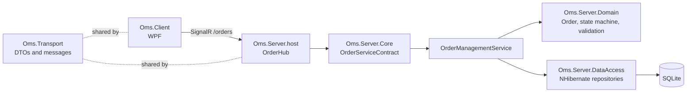
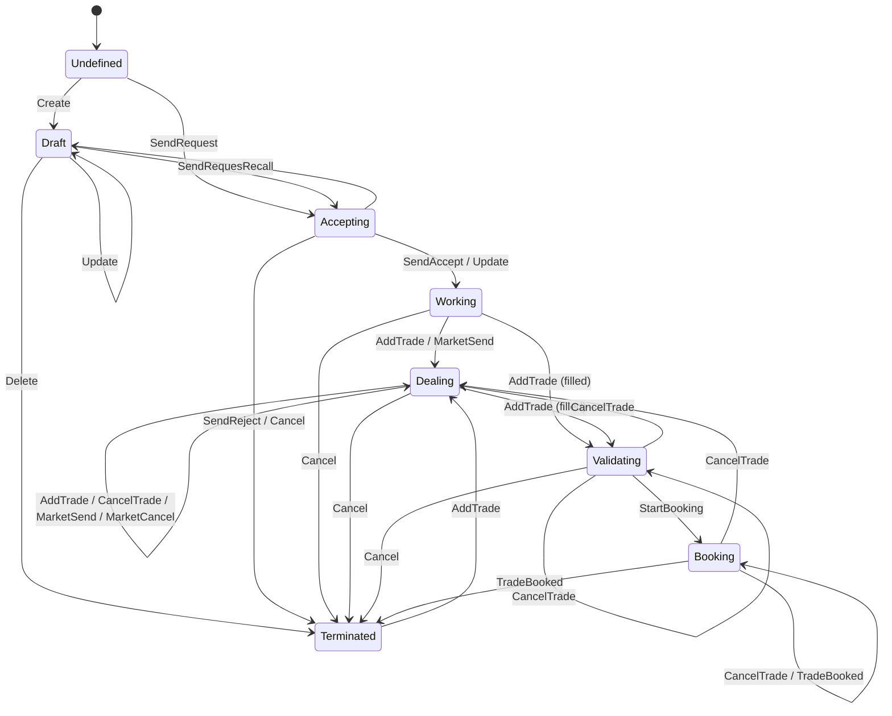

# YOMS architecture

YOMS is a small Order Management System: clients submit orders, the server runs each order through a workflow, persists the full history, and pushes changes back to subscribed clients.

## Components

| Project | Responsibility |
|---|---|
| `Oms.Transport` | DTOs, request/response messages and `IOrderServiceContract`. The only assembly shared by client and server. |
| `Oms.Server.Domain` | Business model: `Order`, `Trade`, `Security`, `Fund`, `User`; the order workflow; FluentValidation validators; repository interfaces. No persistence or transport types. |
| `Oms.Server.DataAccess` | NHibernate/FluentNHibernate automapping and repositories behind `IRepositoryFacade`. Runs on SQLite through `MicrosoftDataSqliteDriver`. |
| `Oms.Server.Core` | Application layer: `OrderManagementService` maps request commands to domain operations, `DtoMapperExtensions` maps domain to DTOs. |
| `Oms.Server.host` | ASP.NET Core process, DI registration and the SignalR `OrderHub`. |
| `Oms.Client` | WPF UI (Caliburn.Micro, MahApps.Metro, MEF, AvalonDock). |
| `Oms.Framework` | Task dispatcher queues/bags and other shared utilities. |

## Request flow

1. The client sends a request (`OrderEditionRequest`, `OrderRequest` or `OrderMarketRequest`) to a hub method: `HandleOrderEdition`, `HandleOrder` or `HandleOrderMarket`. SignalR does not allow overloaded hub methods, hence three names.
2. `OrderHub` forwards to `IOrderServiceContract` (`OrderServiceContract`), which calls `OrderManagementService.HandleRequest`.
3. `OrderManagementService` resolves the user from the request token, then looks up the command (`EditionCommand`, `OrderStateCommand`, `OrderMarketCommand`) in `OrderCommandMappings` and invokes the matching `Order` method (`Create`, `SendRequest`, `Update`, `Cancel`, `MarketSend`, ...).
4. Each call fires a trigger on the order's state machine. The result is a `GenericResult`.
5. Clients call `SubscribeToEvents` to join a SignalR group. `OrderServiceContract.OrderListUpdated` is forwarded by the host to that group as `OrderListUpdated(ItemOperationType, OrderDto[])`.

> Work in progress: the three `OrderServiceContract.Handle*` methods call the management service but still return `null`, and nothing raises `OrderListUpdated` yet.

## Order model: event sourcing

An `Order` has no stored state field. It holds a list of `OrderEventLog` entries (`EventLogs`); each records the trigger, its `TriggerStatus`, the resulting `OrderStateMachine.State`, the `TriggerContext` (user and date) and, for data changes, the editable or dealing parameters.

`Order.ComputeOrderData()` replays the non-failed events to rebuild the current `OrderData` (editable data, routing/dealing data, state, pending trigger) and then derives `OrderStatus` (New, PartiallyFilled, Filled, Cancelled, ...). The state machine is re-initialised from that state before each command, so the log is the single source of truth.

## Order workflow

The state machine is designed in `Oms.Server.Domain/Workflow/OrderStateMachine.stateless` (Stateless Designer) and generated into `OrderStateMachine.cs`. Guards are exposed as `GuardClauseFrom<A>To<B>UsingTrigger<T>` delegates, `OrderStateMachine.Custom.cs` adds the initialisation trigger.

Where two transitions share a trigger (for example `AddTrade` from `Working`), guards pick the target, typically whether the order is fully filled (`IsFilled`).

## Persistence

`NHibernateHelper` (internal singleton) builds the session factory with FluentNHibernate automapping over the `Order` assembly (`DefaultLazy.Never`, event-log base types ignored) and creates the schema on start-up. The provider comes from the `OmsDB` connection string in `App.config`; SQLite is wired through `Microsoft.Data.Sqlite`, an Oracle branch exists but needs a .NET provider package.

## Known gaps

See `AGENTS.md`. In short: unfinished service responses and notifications, 4 failing domain tests, an unexercised WPF client and untested SignalR round trip.
